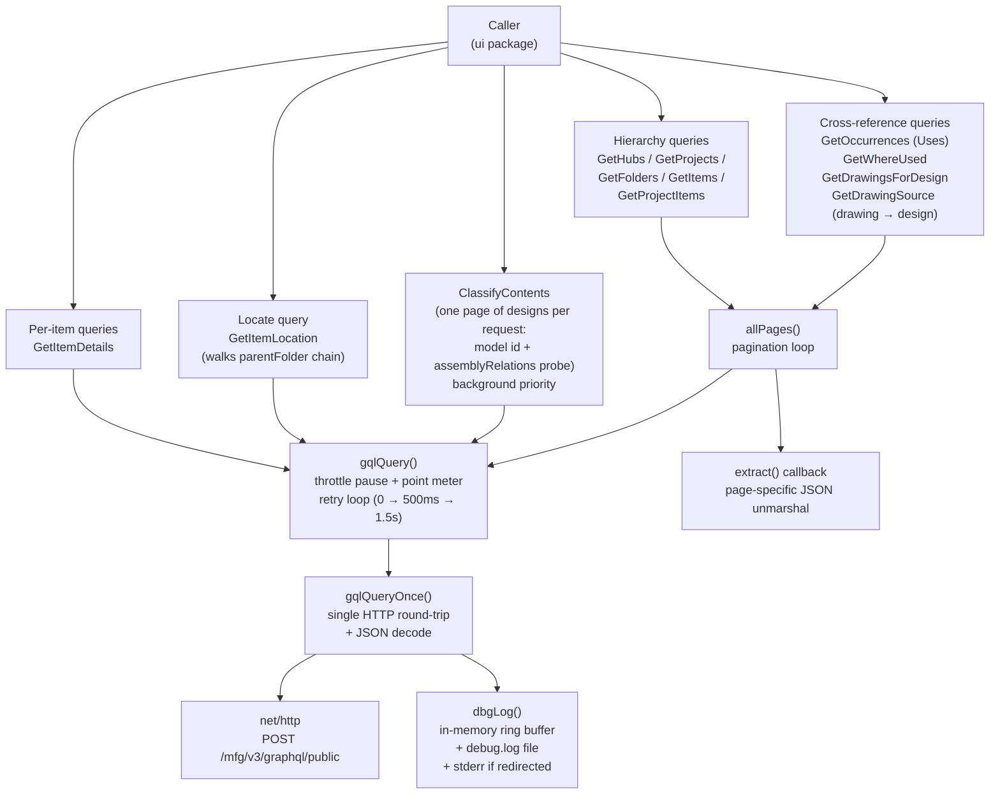
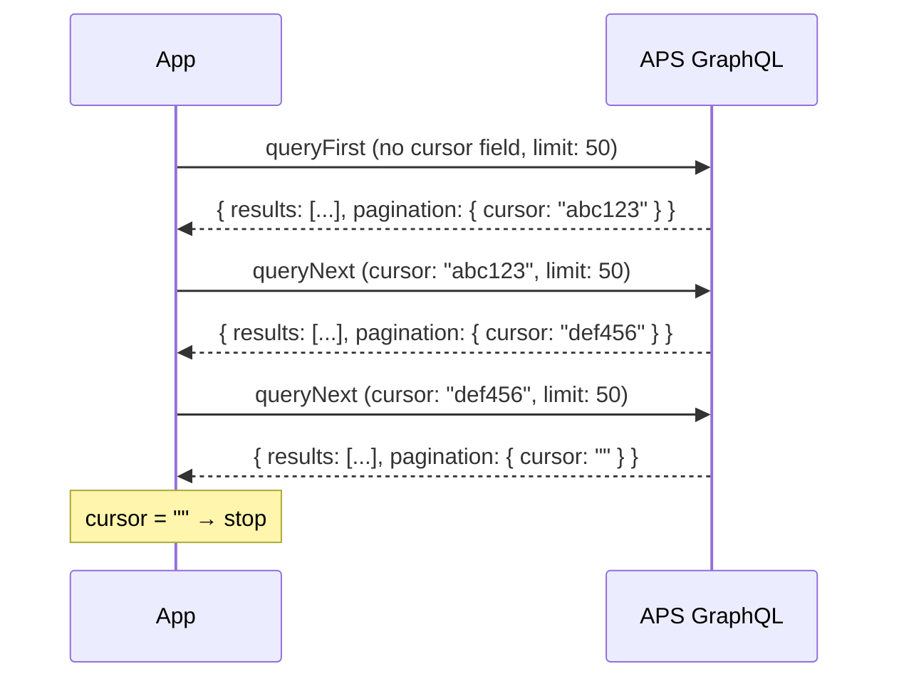
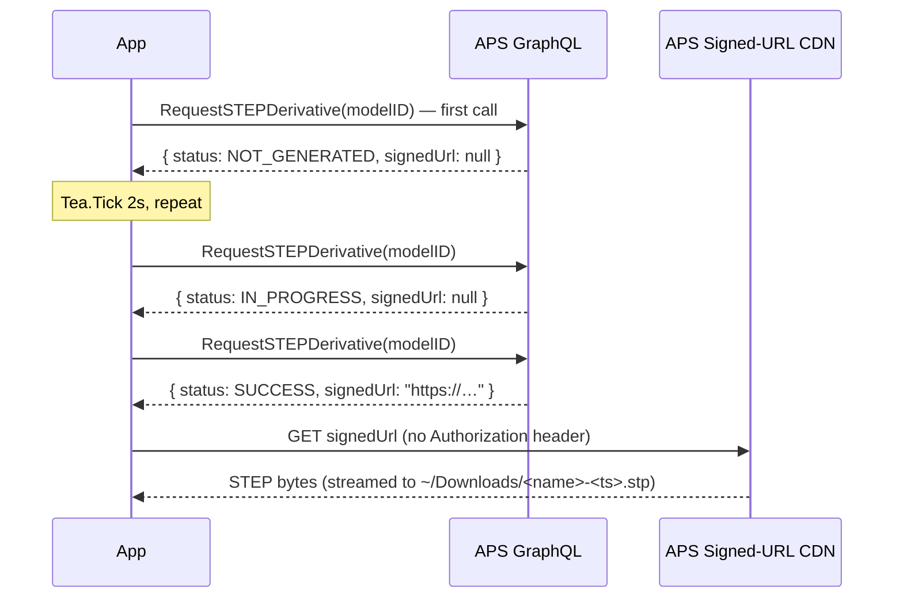

# APS Manufacturing Data Model API

FusionDataCLI queries the **APS Manufacturing Data Model GraphQL API v3** to retrieve hub, project, folder, and item data. All requests are authenticated with a Bearer token obtained through the OAuth PKCE flow.

The app moved from v2 to v3 in November 2026. What changed, what was verified against live hubs, and what could not be verified is recorded in [`api-v3-migration.md`](api-v3-migration.md).

---

## GraphQL Endpoint

```
POST https://developer.api.autodesk.com/mfg/v3/graphql/public
Content-Type: application/json
Authorization: Bearer <access_token>
X-Ads-Region: <region>          (optional — US default, EMEA, or AUS)
```

The `X-Ads-Region` header is only sent when a non-default region is configured. It is omitted entirely for US hubs.

---

## API Client Design



---

## Pagination Strategy

The APS GraphQL API uses **cursor-based pagination**. A page returns a cursor string; passing that cursor in the next request fetches the following page. An empty cursor means the last page has been reached.

**Critical implementation detail:** The API rejects a first-page request that includes a `cursor` variable set to `null` or `""`. Two separate query strings are used per endpoint — one without a cursor parameter, one with `$cursor: String!`.



`pagination.limit` is a **page-size hint, not an exact cap** on some v3 fields: `assemblyRelations` documents this (1–250, default 250) and in practice returns more rows than asked — `limit: 1` returned 2, `limit: 50` returned 61. Callers must follow the cursor and never assume `len(results) <= limit`. The list queries (`hubs`, `projects`, `itemsByFolder`, …) do honour it.

Pagination limit is set to `50` per page. The APS validator rejects values ≥ 100 outright (`"pagination must be between 0 and 100"`), and even at 99 the GraphQL query-cost cap (1000 points) is exceeded by the field set this app uses — 200 results blew through it. 50 is the original safe value used since v0.1 and is enforced via the `pageSize = 50` constant in `api/queries.go`.

---

## Queries

### GetHubs

Fetches all hubs the authenticated user has access to.

```graphql
# First page
query GetHubs {
    hubs(pagination: { limit: 50 }) {
        pagination { cursor }
        results { id name }
    }
}
```

Only `id` and `name` are asked for. `fusionWebUrl` and `alternativeIdentifiers` each cost 5 query points per row requested (250 for the page, however many hubs there are) and nothing read them; the page now costs 11 points instead of 511.

---

### GetProjects

Fetches projects within a hub. Uses the `hub(hubId)` nested resolver. Inactive projects are filtered client-side.

```graphql
# First page
query GetProjects($hubId: ID!) {
    hub(hubId: $hubId) {
        projects(pagination: { limit: 50 }) {
            pagination { cursor }
            results {
                id
                name
                fusionWebUrl
                projectStatus
                alternativeIdentifiers {
                    dataManagementAPIProjectId
                }
            }
        }
    }
}

# Subsequent pages
query GetProjectsNext($hubId: ID!, $cursor: String!) {
    hub(hubId: $hubId) {
        projects(pagination: { cursor: $cursor, limit: 50 }) {
            pagination { cursor }
            results { ... }
        }
    }
}
```

**Filtering:** Projects where `projectStatus` is `INACTIVE` (compared case-insensitively) are excluded from results. `projectType` is deprecated in v3 (every project is now `FOLDER_LEVEL`) and is no longer requested.

---

### GetFolders

Fetches top-level folders for a project.

```graphql
# First page
query GetFolders($projectId: ID!) {
    foldersByProject(projectId: $projectId, pagination: { limit: 50 }) {
        pagination { cursor }
        results {
            id
            name
        }
    }
}
```

Folders have no `fusionWebUrl` — their URL is constructed from project context when needed.

---

### GetProjectItems

Fetches items (designs, drawings) directly under a project root (not inside a folder).

```graphql
# First page
query GetProjectItems($projectId: ID!) {
    itemsByProject(projectId: $projectId, pagination: { limit: 200 }) {
        pagination { cursor }
        results {
            __typename
            id
            name
        }
    }
}
```

---

### GetItems

Fetches items within a specific folder.

```graphql
# First page
query GetItems($hubId: ID!, $folderId: ID!) {
    itemsByFolder(hubId: $hubId, folderId: $folderId, pagination: { limit: 200 }) {
        pagination { cursor }
        results { __typename id name }
    }
}
```

The list is deliberately lean. A list page is charged per row *asked for* times the fields that carry a cost, and `__typename`, `id` and `name` carry none: the page costs 11 query points at any size. With `tipRootModel { id }` on it, as before, a page of 50 cost 261 points even for an empty folder. `GetProjectItems` is the same. See [throttling.md](throttling.md).

`itemsByFolder` returns documents only. A folder's sub-folders come from `GetSubFolders`:

```graphql
query GetSubFolders($hubId: ID!, $folderId: ID!) {
    foldersByFolderInHub(hubId: $hubId, folderId: $folderId, pagination: { limit: 50 }) {
        pagination { cursor }
        results { id name }
    }
}
```

The UI asks for both when a folder is opened and lists the folders first. Without the second query a folder that holds only sub-folders looks empty.

---

### ClassifyContents — assembly/part tags

Refines design rows from a generic "design" to `assembly` or `part` after the list has rendered, and supplies each design's root model id. Lives in `api/classify.go`.

```graphql
query ClassifyContents($hubId: ID!, $id: ID!) {
    list: itemsByFolder(hubId: $hubId, folderId: $id, pagination: { limit: 50 }) {
        pagination { cursor }
        results {
            __typename id
            ... on DesignItem {
                tipRootModel {
                    id
                    assemblyRelations(depth: 1, pagination: { limit: 1 }) { results { id } }
                }
            }
        }
    }
}
```

(`itemsByProject(projectId: $id …)` for a project root; `cursor: $cursor` for later pages.) Any direct child means assembly, none means part. `depth: 1` matters — without it `assemblyRelations` walks the whole tree. The limit is a hint (the probe usually returns two rows), which is harmless here.

It costs 11 points per row asked for, so the UI asks for exactly the documents a page covers, at most 50 (561 points), and only for the page under the cursor and the one after it; later pages are fetched as the cursor approaches. A container with no designs is never asked, and tags are cached by item id for the session. One request covers a page; the earlier per-design `ClassifyAssembly` probe was one request for each design in the folder.

`Component.hasChildren` looks like the cheaper signal. It is **not usable**: it returns `true` for single-body parts (a library screw with zero assembly relations reports `hasChildren: true`), so the relation probe stays.

**Priority.** The request is sent with `api.Background(ctx)`: it waits while it would take the points spent in the last minute past `BackgroundPointBudget` (5,000), so tags never crowd out navigation.

**Cancellation.** The Model's `contentsGen` counter is incremented every time the Contents slice is replaced. Each page carries the gen it was dispatched under; the Update handler drops a `contentsClassifiedMsg` whose gen no longer matches. A failed page leaves the rows with the generic design icon and is not retried for that folder.

---

### GetItemDetails

Fetches rich metadata for a single item plus its version history.

```graphql
query GetItemDetails($hubId: ID!, $itemId: ID!) {
    item(hubId: $hubId, itemId: $itemId) {
        __typename
        id
        name
        size
        mimeType
        extensionType
        createdOn
        createdBy  { firstName lastName }
        lastModifiedOn
        lastModifiedBy { firstName lastName }

        ... on DesignItem {
            fusionWebUrl
            tipRootModel {
                id
                materialName { value }
                component { partNumber { value } description { value } }
            }
            history(input: { filterTypes: [MODEL_WRITTEN, VERSION_CREATED] }, pagination: { limit: 50 }) {
                pagination { cursor }
                results { __typename timestamp description author { firstName lastName } }
            }
        }
        ... on DrawingItem {
            fusionWebUrl
            history(input: { filterTypes: [DRAWING_WRITTEN] }, pagination: { limit: 50 }) { ... }
        }
        ... on ConfiguredDesignItem {
            fusionWebUrl
            history(input: { filterTypes: [MODEL_WRITTEN, VERSION_CREATED] }, pagination: { limit: 50 }) { ... }
        }
        ... on BasicItem {
            history(input: { filterTypes: [BASIC_ITEM_WRITTEN] }, pagination: { limit: 50 }) { ... }
        }
    }
}
```

**Properties are objects.** `name`, `partNumber`, `description`, and `materialName` on `Model` / `Component` are `Property` objects in v3; the string is in `.value`. (`Item.name` is still a plain string.) Part number and description moved from the component version to `tipRootModel.component`; material stays on the model.

**Versions come from history.** v3 has no `itemVersions` query, no `tipVersion`, and no version numbers. An item's versions are the "written" entries of its `history`:

- The filter has to be spelled out per item type. Each concrete type accepts only its own change types — asking a `DesignItem` for `DRAWING_WRITTEN` is a `BAD_REQUEST` (`Invalid filter type`) that nulls the whole `item`.
- Entries arrive newest first. `GetItemDetails` numbers them from the oldest (= 1), so `VersionNumber` is the count of written entries. This reproduced the v2 `versionNumber` on all 15 designs it was compared against.
- If the first page returns a cursor, a follow-up `GetItemHistoryNext` query (history fragments only) walks the rest, bounded at 40 pages.
- `VersionSummary.Comment` is the entry's `description` ("User Saved", "Auto save in Fusion: …", "Imported from …"). In v2 this field was `itemVersions.name`, which only ever echoed the item name.
- `VERSION_CREATED` entries (Fusion's "Create version" milestones) are requested for designs but not counted as versions. `IsMilestone` is true when the newest entry is one — see the caveat in [`api-v3-migration.md`](api-v3-migration.md#unverified).

---

### RequestSTEPDerivative

Asks APS to translate a design's tip root model into a STEP file and report the signed download URL when ready. Used by the `shift+d` key in the UI. Lives in `api/download.go`.

```graphql
query GetGeometry($modelId: ID!) {
    model(modelId: $modelId) {
        derivatives(derivativeInput: { targetFormat: [STEP], generate: true }) {
            expires
            signedUrl
            status
            outputFormat
        }
    }
}
```

The same query both **kicks off** generation (the first call, when no derivative exists yet) and **reports current status** thereafter. APS keeps the worker running between calls, so the client polls until status reaches `SUCCESS` or `FAILED`:



`RequestSTEPDerivative` returns `(status, signedURL, err)` with status normalised to the three constants `StepStatusPending`, `StepStatusSuccess`, `StepStatusFailed`:

| API `status` | Returned as |
|---|---|
| `SUCCESS` | `SUCCESS` (with `signedURL`) |
| `FAILED`, `TIMEOUT` | `FAILED` — `TIMEOUT` is terminal, polling on would never finish |
| `NOT_GENERATED`, `PENDING`, `IN_PROGRESS`, anything unrecognised | `PENDING` — keep polling |

**Restrictions:**

- Only valid on `DesignItem`. Drawings, configured designs, and folders/projects have no `tipRootModel`. The UI checks `details.Typename == "DesignItem"` and `details.RootModelID != ""` before issuing the call.
- The signed URL expires (the `expires` field is returned but currently unused — the client downloads immediately after `SUCCESS`).

#### DownloadFile

Streams the signed-URL response to a destination path. Critically, **the user's bearer token is intentionally NOT attached** — APS signed URLs are self-authenticated (the signature is embedded in the URL) and adding a bearer would leak the access token to whatever host the signed URL points at. If a poisoned or MITM'd GraphQL response ever returned a non-Autodesk URL, the blast radius is confined to the (already untrusted) signed URL itself.

```go
func DownloadFile(ctx context.Context, url, destPath string) error
```

The destination directory is created (`0755`) if needed; the file is written via `os.Create`. Non-2xx responses are surfaced with the first 2 KiB of the body for diagnostics.

#### StepDownloadPath

Returns a sensible local path for a STEP file derived from `name`:

- Prefers `~/Downloads/<sanitised-name>-<YYYYMMDD-HHMMSS>.stp`
- Falls back to `os.TempDir()` if `os.UserHomeDir()` fails or returns empty
- Filenames are sanitised to alphanumerics + `- _ . space` (everything else becomes `_`) so the path round-trips cleanly across Linux, macOS, and Windows

The `userHomeDir` and `nowFunc` package vars are swappable by tests for deterministic output (see Testing below).

---

## NavItem Struct

All list queries produce `[]NavItem`. This is the fundamental navigation unit passed between the `api` and `ui` packages.

```go
type NavItem struct {
    ID          string  // GraphQL node ID
    Name        string
    Kind        string  // see table below
    AltID       string  // dataManagementAPIHubId or dataManagementAPIProjectId
    WebURL      string  // fusionWebUrl if available
    IsContainer bool    // true for hub, project, folder

    // RootModelID is the id of the design's tipRootModel, captured by
    // GetItems / GetProjectItems via the ... on DesignItem inline
    // fragment so the async classifier can probe assembly relations
    // directly without a per-row round-trip.
    // Populated only for Kind == "design"; empty for everything else.
    RootModelID string

    // Subtype refines Kind into a displayed type tag in the Contents
    // column. Two fill paths:
    //
    //   - Designs: filled in asynchronously by ClassifyContents
    //     ("assembly" | "part" | "" while in flight)
    //   - Drawings: filled in synchronously from the filename
    //     extension at items-list time ("dwg" | "template")
    //
    // For Fusion Electronics types (pcb / schematic / ecad) the Kind
    // itself implies the tag; Subtype is unused. See subtypeSuffix()
    // in ui/app.go for the full label table.
    Subtype string
}
```

**Kind mapping — combined `__typename` + filename extension:**

The primary signal is `__typename`. When that comes back as anything outside the table below, `navItemFromResult` falls back to `kindFromExtension(item.name)` so Fusion Electronics rows (which have no typename of their own — the v3 `Item` interface has only the four concrete types `BasicItem`, `ConfiguredDesignItem`, `DesignItem`, `DrawingItem`) still get a useful Kind.

| Source | Value | `Kind` | `IsContainer` | Notes |
|---|---|---|---|---|
| (set explicitly) | hub | `"hub"` | `true` | |
| (set explicitly) | project | `"project"` | `true` | |
| `__typename` | `Folder` | `"folder"` | `true` | |
| `__typename` | `DesignItem` | `"design"` | `false` | `RootModelID` and `Subtype` filled async by `ClassifyContents` |
| `__typename` | `DrawingItem` | `"drawing"` | `false` | `Subtype` filled synchronously: `"template"` for `.f2t`, `"dwg"` otherwise |
| `__typename` | `ConfiguredDesignItem` | `"configured"` | `false` | |
| extension | `.f3d` | `"design"` | `false` | Fallback when typename is unknown |
| extension | `.f2d` / `.f2t` | `"drawing"` | `false` | Fallback |
| extension | `.fsch` | `"schematic"` | `false` | Fusion schematic |
| extension | `.fbrd` | `"pcb"` | `false` | Fusion PCB board |
| extension | `.fprj` | `"ecad"` | `false` | Fusion Electronics project archive |
| (none of the above) | — | `"unknown"` | `false` | Logged at debug; renderer shows the row with the default design icon and no type tag |

---

## ItemDetails Struct

Returned by `GetItemDetails`. Contains everything needed for the details panel.

```go
type ItemDetails struct {
    ID            string
    Name          string
    Typename      string        // DesignItem | DrawingItem | ConfiguredDesignItem | BasicItem
    Size          string        // raw bytes as string from API
    MimeType      string
    ExtensionType string
    FusionWebURL  string
    CreatedOn     time.Time
    CreatedBy     string        // "First Last"
    ModifiedOn    time.Time
    ModifiedBy    string
    VersionNumber int           // count of "written" history entries
    // Design-specific
    PartNumber  string          // tipRootModel.component.partNumber.value
    PartDesc    string          // tipRootModel.component.description.value
    Material    string          // tipRootModel.materialName.value
    IsMilestone bool            // newest history entry is a VERSION_CREATED
    RootModelID string          // tipRootModel.id — Uses tab + STEP key
    // Versions — most recent first
    Versions []VersionSummary
}

type VersionSummary struct {
    Number    int
    CreatedOn time.Time
    CreatedBy string
    Comment   string           // history entry description (may be empty)
}
```

---

## Cross-reference Queries (Details-pane tabs)

The Uses, Where Used, and Drawings tabs each call a dedicated query in `api/refs.go`. All four are far simpler on v3 than they were on v2, because v3 relates *items* and *models* directly instead of pinning every relationship to one specific component version.

### GetOccurrences — Uses tab on a DesignItem

```graphql
query GetOccurrences($modelId: ID!) {
  model(modelId: $modelId) {
    assemblyRelations(depth: 1, pagination: { limit: 50 }) {
      pagination { cursor }
      results {
        id
        toModel {
          id
          name { value }
          materialName { value }
          component { partNumber { value } description { value } }
          designItem { id name fusionWebUrl }
        }
      }
    }
  }
}
```

Returns `[]ComponentRef` — one row per direct child instance. This is *instances*, not *unique components* — a design with five identical bolts shows five rows (each relation carries its own `toModelInstanceIndex`).

`depth: 1` is load-bearing. `assemblyRelations` defaults to the **whole tree**: on the 4WD-buggy test assembly the default returned 413 relations across 42 parent models, where `depth: 1` returned the 41 direct children — the same 41 that v2 `occurrences` returned.

### GetWhereUsed — the design's direct parents

```graphql
query GetWhereUsed($hubId: ID!, $itemId: ID!) {
  item(hubId: $hubId, itemId: $itemId) {
    whereUsed(pagination: { limit: 10 }) {    # 25 on later pages
      pagination { cursor }
      results {
        __typename id name
        ... on DesignItem {
          fusionWebUrl
          tipRootModel {
            id
            materialName { value }
            component { partNumber { value } description { value } }
          }
        }
        ... on ConfiguredDesignItem { fusionWebUrl }
      }
    }
  }
}

# One request for all design rows (up to 25 per request), to find which
# of them hold the design at their first level; p0, p1, … are the rows'
# root models
query WhereUsedIsDirect($m0: ID!, $m1: ID!) {
  p0: model(modelId: $m0) {
    assemblyRelations(scope: INTERNAL_PLUS_DIRECT_EXTERNAL, pagination: { limit: 250 }) {
      pagination { cursor }
      results { toModel { designItem { id } } }
    }
  }
  p1: model(modelId: $m1) { … }
}
```

The tab shows **direct parents only**: the designs that hold the selected design at their own first level.

Where-used moved from the component version to the **item** (`Item.whereUsed`), so the lookup takes `hubId` + `itemId`. The schema describes `whereUsed` as "the immediate parents in which this item is used", but on live data it returns much more, and nothing in the response says which row is which:

- every assembly above the design, however many levels up;
- drawings, of the design and of those assemblies;
- documents whose current version no longer references the design (older-version users, hidden wrapper documents around imported files).

So `GetWhereUsed` runs both queries and filters. Measured on the test hub: a shock shaft for which the API lists 7 designs and a drawing comes back as its 2 direct parents.

- **Drawings are dropped.** The design's drawings are on the Drawings tab (`GetDrawingsForDesign`); a drawing of an assembly further up is not a use of this design.
- **Design rows are checked.** A single `WhereUsedIsDirect` request reads every listed design's first-level references, each under its own alias, and looks for this item. `scope: INTERNAL_PLUS_DIRECT_EXTERNAL` returns the design's internal components plus the external designs inserted into them, without descending into those designs. A request takes over a second however little it asks, so seven rows batched cost about what one does alone. Each row scores 12 query points; batches hold 25. The page size is 250, the API maximum, which costs the same as 50; a design with more references than that and no match yet goes round again with its cursor.
- **Kept, `Relation: direct`:** the item is among the design's first-level references.
- **Dropped:** a design that has references but not this item at their first level (an ancestor further up), and a design whose current version references nothing at all.
- **Kept, `Relation` empty (shown as `unconfirmed`):** a row that could not be checked, so that a failed check never hides a real parent. That is a design whose references cannot be read (a damaged document answers `DATA_HAS_ERROR`, beside the others' answers; the request is not repeated), every design row when the relation request itself fails, and configured designs, which are not asked. Only a batch the API refuses outright is asked again one row at a time.

The result reflects what the signed-in user can see: a parent in a project they cannot read is not returned by `whereUsed`.

`whereUsed` can also return an item the API cannot read (every field null, with an internal server error on that result). It has no model to check, so it is listed as `unconfirmed` with the name `(unnamed item)`.

**Cost and latency.** The first page asks for 10 rows and costs 211 points (was 327 with the nested lookups for drawing and root tags); later pages ask for 25. The upstream lookup is slow — 5 to 20 s for a design with several ancestors — and about one time in three answers a path-less `INTERNAL_SERVER_ERROR`, sometimes with part of the rows. That answer is treated as transient and asked again; the partial rows are never used. The tab's load has its own 90 s timeout for that reason.

### GetDrawingsForDesign — Drawings tab on a DesignItem

```graphql
query GetDrawingsForDesign($hubId: ID!, $itemId: ID!) {
  item(hubId: $hubId, itemId: $itemId) {
    ... on DesignItem {
      drawingItems(pagination: { limit: 50 }) {
        pagination { cursor }
        results {
          id name fusionWebUrl
          lastModifiedOn
          lastModifiedBy { firstName lastName }
        }
      }
    }
  }
}
```

`DesignItem.drawingItems` — "all DrawingItems that reference this DesignItem" — answers the question in one hop. The v2 implementation had to page through every saved version of the design and collect each version's `drawingItemVersions`, because a v2 drawing pointed at one specific component version and disappeared from the tip as soon as the design was saved again.

The list is returned newest-modified first.

### GetDrawingSource — Uses tab on a DrawingItem

```graphql
query GetDrawingSource($hubId: ID!, $itemId: ID!) {
  item(hubId: $hubId, itemId: $itemId) {
    ... on DrawingItem {
      tipDrawing {
        model {
          id
          name { value }
          materialName { value }
          component { partNumber { value } description { value } }
          designItem { id name fusionWebUrl }
        }
      }
    }
  }
}
```

Returns `[]ComponentRef` of length 0 or 1. `DrawingItem.designItem` is a shorter path to the same design, but it is declared non-null, so a drawing whose source is gone would fail the whole `item`; the nullable `tipDrawing.model` chain degrades to an empty tab instead.

### GetItemLocation — Show in Location

```graphql
# 1. Item's project + immediate parent folder
query LocateItem($hubId: ID!, $itemId: ID!) {
  item(hubId: $hubId, itemId: $itemId) {
    project {
      id name
      hub { id }
      alternativeIdentifiers { dataManagementAPIProjectId }
    }
    parentFolder { id name }
  }
}

# 2. Walk parentFolder up to the project root, one query per level
query GetFolderParent($hubId: ID!, $folderId: ID!) {
  folderByHubId(hubId: $hubId, folderId: $folderId) {
    parentFolder { id name }
  }
}
```

Returns `*ItemLocation` containing the project (id, name, altID, hub id) and a root→leaf folder path. The walk is iterative (one round trip per ancestor level) and capped at 100 hops as a defence against malformed schema responses with cycles. Typical folder trees are 2–4 levels deep, so the cost is modest.

```go
type ItemLocation struct {
    HubID        string
    ProjectID    string
    ProjectAltID string
    ProjectName  string
    FolderPath   []FolderRef // root → ... → leaf parent; empty if item is in project root
}

type FolderRef struct {
    ID   string
    Name string
}
```

The UI consumes this in `handleItemLocation` to: (1) verify the hub matches the current selection, (2) find the project in `m.cols[colProjects]` and move the cursor, (3) queue a `pendingNavState` with the folder chain, (4) drill folder-by-folder via `loadItemsCmd` until the leaf, (5) place the cursor on the target item. See [`docs/navigation.md`](navigation.md#tab-cursor-and-show-in-location) for the user-visible flow.

---

## Timestamp Parsing

The API returns timestamps in ISO-8601 format. Two formats are handled:

```go
// Primary: RFC 3339
time.Parse(time.RFC3339, s)           // "2026-03-15T14:30:00Z"

// Fallback: millisecond variant
time.Parse("2006-01-02T15:04:05.000Z", s)   // "2026-03-15T14:30:00.000Z"
```

---

## Error Handling and Retry

GraphQL errors are returned in a top-level `errors` array alongside `data`. Each error carries `extensions.code`, `extensions.errorType`, and `extensions.correlation_id`. The client collects all error messages and joins them with `"; "`:

```json
{
  "errors": [
    {
      "message": "Requested resource not found.",
      "extensions": {
        "code": "NOT_FOUND",
        "errorType": "UNKNOWN",
        "service": "cw",
        "correlation_id": "..."
      }
    }
  ]
}
```

**HTTP-level errors:**
- `401 Unauthorized` → short-circuited before body parsing; surfaced as `"unauthorized (HTTP 401) — token may be expired or lacks scope/entitlement; body: <raw>"`. Bypassing the JSON decode avoids spurious "parsing GraphQL response" errors when APS returns a non-JSON 401 body.
- `408 / 5xx` → retried (see below).
- `429` → the per-minute query quota is spent. Not retried on the flakiness schedule: every request waits out a shared pause and is then sent again. See [throttling.md](throttling.md).
- Other 4xx → response body parsed and surfaced verbatim, no retry.

### Bounded retry on transient APS gateway flakiness

The v2 MFG GraphQL gateway intermittently returned `code:NOT_FOUND, errorType:UNKNOWN` for hub URNs it had just enumerated: same query, token and URN succeeding and failing within seconds. `gqlQuery` wraps `gqlQueryOnce` in a 3-attempt loop with backoffs `0 → 500 ms → 1.5 s` to absorb it.

`gqlQueryOnce` classifies each round-trip:

| Response | Outcome |
|---|---|
| Transport error, HTTP 408 / 5xx | transient — next attempt |
| HTTP 429, or the quota message under any status | throttled — shared pause, then again; not an attempt |
| HTTP 401, unparsable body, no data and no errors | fatal |
| GraphQL error with `errorType: UNKNOWN`, at the root or path depth ≤ 2, whose code is not deterministic | transient |
| GraphQL error that nulled the root field | fatal |
| Any other GraphQL error | the data is passed through; the error goes to the debug log |

Deterministic codes are never retried, whatever `errorType` says: `EXCEPTION_CLOSED_COMMUNITY`, `FORBIDDEN`, `UNAUTHORIZED`, `BAD_REQUEST`, `BAD_USER_INPUT`, `GRAPHQL_VALIDATION_FAILED`. The list exists because `errorType: UNKNOWN` alone does not mean transient: a document in a closed project fails on `fusionWebUrl` (path depth 2) with `EXCEPTION_CLOSED_COMMUNITY` and `UNKNOWN` on every request, with the rest of the item intact. The earlier rule retried that three times and reported it as flaky, so such a document's details could not be shown.

After 3 transient attempts the error reads `APS GraphQL flaky after 3 attempts: <last error>`. Every GraphQL error message carries its code and path, e.g. `… [NOT_FOUND at hub.projects]`.

---

### Query points and the per-minute quota

Every query has a point value, reported in `extensions.pointValue.requestedQueryPointValue`. Two limits apply:

- **Per query: 1000 points.** A list costs 11 points whatever its page size. Selecting an object under each result (a design's `tipRootModel`, say) adds about 5 points per row *asked for* — the page size, not what comes back. Nested lists multiply.
- **Per minute.** Once a minute's points are spent the API answers **HTTP 429** with `Query point value per minute quota exceeded with point value of N and remaining quota M`. On the test account the quota behaved like 10,000 points a minute. There was no `Retry-After` header. The counter punishes bursts: a client that spent 8,000 points, waited out the minute and spent 8,000 more was still throttled, so the audit spends at a steady rate instead.

Interactive browsing can reach the per-minute quota, and before the changes described in [throttling.md](throttling.md) it did so easily: every folder cost 261 points to open. `gqlQuery` now waits out a 429 behind a pause shared by all requests, meters the points it spends, and holds background requests while the minute is mostly spent.

### QueryRaw — one round-trip, nothing hidden

`gqlQuery` passes partial data through and drops the accompanying errors. That is right for a list on screen and wrong for anything that must account for every row. `api.QueryRaw` performs exactly one request and returns the HTTP status, `Retry-After`, the data, every error with its path, code and correlation id, and the point value. It makes no retry; the caller owns that policy. The hub audit (`audit/`, see [mfgdm-report.md](mfgdm-report.md)) is built on it.

## Debug Mode

Set `APSNAV_DEBUG=1` before running to enable full request/response logging:

```sh
APSNAV_DEBUG=1 fusiondatacli
```

Logs are written to **three sinks**:

1. **In-memory ring buffer** (max 500 lines) — viewed via the `?` overlay from `stateBrowsing`. The overlay shows the current log file path at the top so the user knows where to grab the text from (the rendered overlay text itself is not selectable).
2. **`~/.config/fusiondatacli/debug.log`** — opened with `O_TRUNC` on each session start, mode 0600. The path comes from `config.Dir()`. Tail / grep / open in an editor with standard tools while the TUI is running.
3. **Stderr** — *only* when stderr has been redirected (file or pipe). Detected at startup via `os.Stderr.Stat()`'s `ModeCharDevice` bit; when stderr is the terminal, writing to it would smear bubbletea's alternate-screen render, so the mirror is suppressed in that case. When you want stderr capture explicitly, redirect:

   ```sh
   APSNAV_DEBUG=1 fusiondatacli 2> debug.log
   ```

Each log entry includes:
- Query name and variables
- HTTP status code
- Raw JSON response body
- `RETRY attempt=N delay=… lastErr=…` lines whenever the bounded-retry loop kicks in

Authorization headers are never logged. The on-disk log file is mode 0600.

---

## Region Support

APS hubs in EMEA and Australia are served from regional API endpoints. Set the region before running:

```sh
APS_REGION=EMEA fusiondatacli   # Europe, Middle East, Africa
APS_REGION=AUS  fusiondatacli   # Australia
```

Or set `"region": "EMEA"` in `~/.config/fusiondatacli/config.json`.

When a region is set, the `X-Ads-Region` header is added to every GraphQL request.

---

## Testing

The `api` package endpoint is held in a package-level `var` rather than a `const` so tests in any package can swap it for an `httptest.Server` URL:

```go
// api/client.go
var graphqlEndpoint = "https://developer.api.autodesk.com/mfg/v3/graphql/public"
```

Same-package tests (`api/*_test.go`) can write `graphqlEndpoint` directly. Cross-package tests (notably `ui/` flow tests that drive a `tea.Cmd` which internally calls into `api`) use the exported helper:

```go
// SetGraphqlEndpointForTesting overrides graphqlEndpoint and returns a
// restore func. Production code MUST NOT call this.
func SetGraphqlEndpointForTesting(url string) (restore func())
```

Typical use:

```go
srv := testutil.GraphQLServer(t, func(req testutil.GraphQLRequest) testutil.GraphQLResponse {
    return testutil.GraphQLResponse{ Data: map[string]any{ /* ... */ } }
})
restore := api.SetGraphqlEndpointForTesting(srv.URL)
defer restore()
// drive UI / api code under test...
```

`testutil.GraphQLServer` is in the shared `internal/testutil/` package — see [`docs/architecture.md`](architecture.md) and [`docs/development.md`](development.md) for the full test strategy.

The `download.go` package vars `userHomeDir` and `nowFunc` follow the same pattern: tests overwrite them to redirect downloads into a `t.TempDir()` and produce deterministic timestamps.
