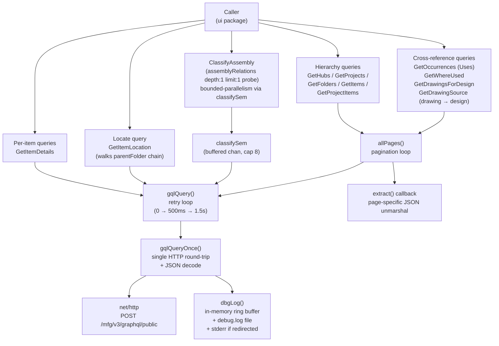
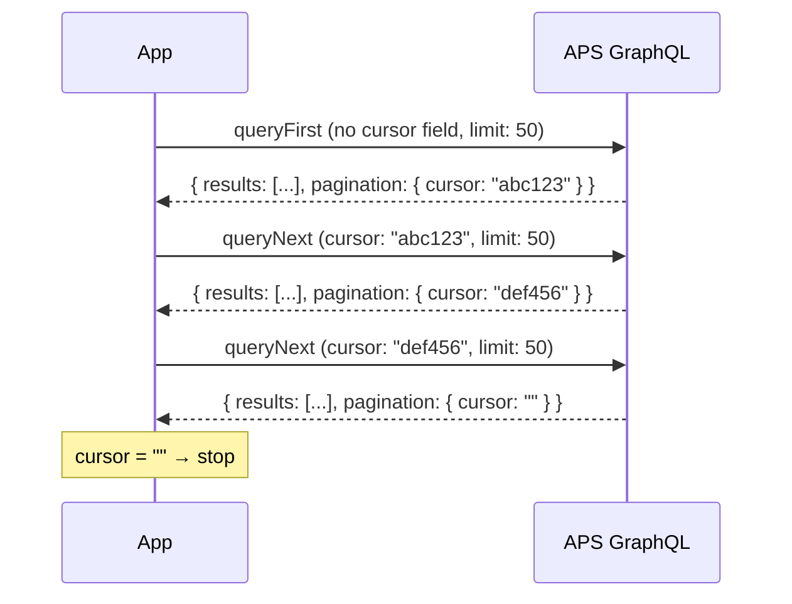
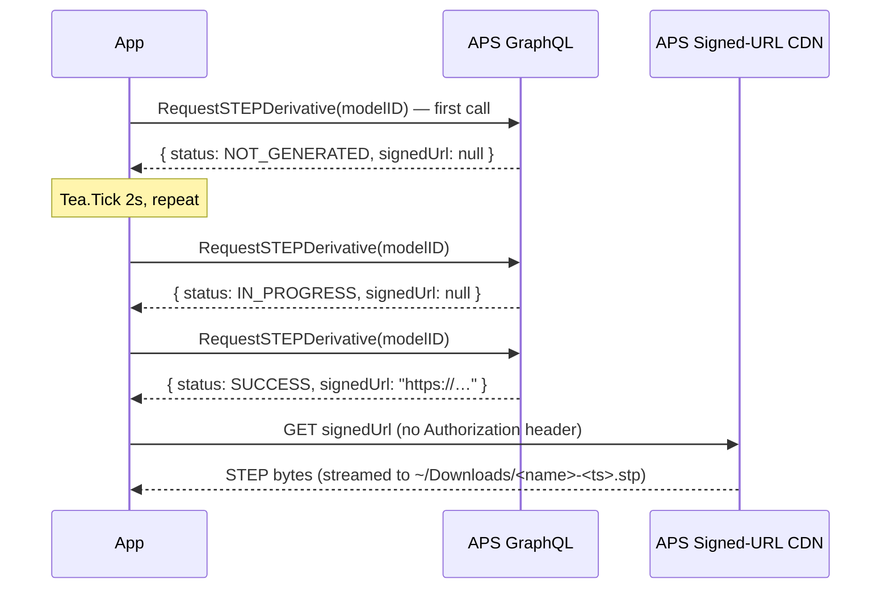

# APS Manufacturing Data Model API

FusionDataCLI queries the **APS Manufacturing Data Model GraphQL API v3** to retrieve hub, project, folder, and item data. All requests are authenticated with a Bearer token obtained through the OAuth PKCE flow.

The app moved from v2 to v3 in November 2026. What changed, what was verified against live hubs, and what could not be verified is recorded in [`api-v3-migration.md`](api-v3-migration.md).

---

## GraphQL Endpoint

```
POST https://developer.api.autodesk.com/mfg/v3/graphql/public
Content-Type: application/json
Authorization: Bearer <access_token>
X-Ads-Region: <region>          (optional — US default, EMEA, or AUS)
```

The `X-Ads-Region` header is only sent when a non-default region is configured. It is omitted entirely for US hubs.

---

## API Client Design



---

## Pagination Strategy

The APS GraphQL API uses **cursor-based pagination**. A page returns a cursor string; passing that cursor in the next request fetches the following page. An empty cursor means the last page has been reached.

**Critical implementation detail:** The API rejects a first-page request that includes a `cursor` variable set to `null` or `""`. Two separate query strings are used per endpoint — one without a cursor parameter, one with `$cursor: String!`.



`pagination.limit` is a **page-size hint, not an exact cap** on some v3 fields: `assemblyRelations` documents this (1–250, default 250) and in practice returns more rows than asked — `limit: 1` returned 2, `limit: 50` returned 61. Callers must follow the cursor and never assume `len(results) <= limit`. The list queries (`hubs`, `projects`, `itemsByFolder`, …) do honour it.

Pagination limit is set to `50` per page. The APS validator rejects values ≥ 100 outright (`"pagination must be between 0 and 100"`), and even at 99 the GraphQL query-cost cap (1000 points) is exceeded by the field set this app uses — 200 results blew through it. 50 is the original safe value used since v0.1 and is enforced via the `pageSize = 50` constant in `api/queries.go`.

---

## Queries

### GetHubs

Fetches all hubs the authenticated user has access to.

```graphql
# First page
query GetHubs {
    hubs(pagination: { limit: 50 }) {
        pagination { cursor }
        results {
            id
            name
            fusionWebUrl
            alternativeIdentifiers {
                dataManagementAPIHubId
            }
        }
    }
}

# Subsequent pages
query GetHubsNext($cursor: String!) {
    hubs(pagination: { cursor: $cursor, limit: 50 }) {
        pagination { cursor }
        results {
            id
            name
            fusionWebUrl
            alternativeIdentifiers {
                dataManagementAPIHubId
            }
        }
    }
}
```

**Output fields used:**

| Field | Maps to |
|-------|---------|
| `id` | `NavItem.ID` |
| `name` | `NavItem.Name` |
| `fusionWebUrl` | `NavItem.WebURL` |
| `alternativeIdentifiers.dataManagementAPIHubId` | `NavItem.AltID` (used to build browser URLs) |

---

### GetProjects

Fetches projects within a hub. Uses the `hub(hubId)` nested resolver. Inactive projects are filtered client-side.

```graphql
# First page
query GetProjects($hubId: ID!) {
    hub(hubId: $hubId) {
        projects(pagination: { limit: 50 }) {
            pagination { cursor }
            results {
                id
                name
                fusionWebUrl
                projectStatus
                alternativeIdentifiers {
                    dataManagementAPIProjectId
                }
            }
        }
    }
}

# Subsequent pages
query GetProjectsNext($hubId: ID!, $cursor: String!) {
    hub(hubId: $hubId) {
        projects(pagination: { cursor: $cursor, limit: 50 }) {
            pagination { cursor }
            results { ... }
        }
    }
}
```

**Filtering:** Projects where `projectStatus` is `INACTIVE` (compared case-insensitively) are excluded from results. `projectType` is deprecated in v3 (every project is now `FOLDER_LEVEL`) and is no longer requested.

---

### GetFolders

Fetches top-level folders for a project.

```graphql
# First page
query GetFolders($projectId: ID!) {
    foldersByProject(projectId: $projectId, pagination: { limit: 50 }) {
        pagination { cursor }
        results {
            id
            name
        }
    }
}
```

Folders have no `fusionWebUrl` — their URL is constructed from project context when needed.

---

### GetProjectItems

Fetches items (designs, drawings) directly under a project root (not inside a folder).

```graphql
# First page
query GetProjectItems($projectId: ID!) {
    itemsByProject(projectId: $projectId, pagination: { limit: 50 }) {
        pagination { cursor }
        results {
            __typename
            id
            name
        }
    }
}
```

---

### GetItems

Fetches items within a specific folder.

```graphql
# First page
query GetItems($hubId: ID!, $folderId: ID!) {
    itemsByFolder(hubId: $hubId, folderId: $folderId, pagination: { limit: 50 }) {
        pagination { cursor }
        results {
            __typename
            id
            name
            ... on DesignItem {
                tipRootModel { id }
            }
        }
    }
}
```

The `... on DesignItem` inline fragment captures `tipRootModel.id` per design row in the same query, so the async assembly classifier (see [ClassifyAssembly](#classifyassembly--asyncpartassembly-subtype) below) doesn't have to round-trip back to APS just to discover which model id to probe. A design whose data has not been migrated into the cloud information model returns `tipRootModel: null`; such rows keep the generic design icon and have no tabs. Drawings, configured designs, and folders ignore the fragment and the field simply isn't present in their results. `GetProjectItems` uses the same inline fragment for the project-root items.

---

### ClassifyAssembly — async part/assembly subtype

Lightweight probe used to refine each design row's icon from a generic "design" to either `assembly` or `part` after the items list has rendered. Lives in `api/classify.go`.

```graphql
query ClassifyAssembly($modelId: ID!) {
    model(modelId: $modelId) {
        assemblyRelations(depth: 1, pagination: { limit: 1 }) {
            results { id }
        }
    }
}
```

The query is intentionally cheap (6 points, ~0.7 s). Returning `len(results) > 0` is the entire classification decision: any direct child means assembly, none means part. `depth: 1` matters — without it `assemblyRelations` walks the whole tree. The limit is a hint (the probe usually returns two rows), which is harmless here.

`Component.hasChildren` looks like the aggregate this probe was waiting for, and it could ride along on the items list for free. It is **not usable**: it returns `true` for single-body parts (a library screw with zero assembly relations and zero BOM relations reports `hasChildren: true`), so the relation probe stays.

**Concurrency cap.** A package-level buffered channel acts as a semaphore so a fan-out of N classification cmds from a single `contentsLoadedMsg` translates into at most 8 simultaneous HTTPS round-trips against the gateway:

```go
var classifySem = make(chan struct{}, 8)

func ClassifyAssembly(ctx context.Context, token, modelID string) (bool, error) {
    select {
    case classifySem <- struct{}{}:
    case <-ctx.Done():
        return false, ctx.Err()
    }
    defer func() { <-classifySem }()
    // ... GraphQL call ...
}
```

8 was chosen empirically against a real hub. Higher caps return diminishing throughput per the gateway's per-tenant rate limits; lower caps leave wall-clock latency on the table.

**Cancellation.** `ClassifyAssembly` itself takes a context but does not implement explicit cancellation of in-flight calls when the user navigates away. Instead, the caller-side dispatch flow in `ui/app.go` carries a `contentsGen` counter on the Model that's incremented every time the Contents slice is replaced (folder drill, hub switch, project switch, refresh, error recovery). Each `classifyDesignCmd` captures the gen at dispatch and stamps it on the resulting `itemClassifiedMsg`; the Update handler drops the message when `msg.gen != m.contentsGen`. Late results aren't cancelled mid-flight — they complete, post their message, and get ignored. This is cheap and lock-free; see [`docs/architecture.md`](architecture.md#async-assembly-vs-part-classification) for the full sequence diagram.

The classifier is fire-and-forget; per-row errors keep the row's generic design icon (graceful degradation) and never surface as user-visible noise.

---

### GetItemDetails

Fetches rich metadata for a single item plus its version history.

```graphql
query GetItemDetails($hubId: ID!, $itemId: ID!) {
    item(hubId: $hubId, itemId: $itemId) {
        __typename
        id
        name
        size
        mimeType
        extensionType
        createdOn
        createdBy  { firstName lastName }
        lastModifiedOn
        lastModifiedBy { firstName lastName }

        ... on DesignItem {
            fusionWebUrl
            tipRootModel {
                id
                materialName { value }
                component { partNumber { value } description { value } }
            }
            history(input: { filterTypes: [MODEL_WRITTEN, VERSION_CREATED] }, pagination: { limit: 50 }) {
                pagination { cursor }
                results { __typename timestamp description author { firstName lastName } }
            }
        }
        ... on DrawingItem {
            fusionWebUrl
            history(input: { filterTypes: [DRAWING_WRITTEN] }, pagination: { limit: 50 }) { ... }
        }
        ... on ConfiguredDesignItem {
            fusionWebUrl
            history(input: { filterTypes: [MODEL_WRITTEN, VERSION_CREATED] }, pagination: { limit: 50 }) { ... }
        }
        ... on BasicItem {
            history(input: { filterTypes: [BASIC_ITEM_WRITTEN] }, pagination: { limit: 50 }) { ... }
        }
    }
}
```

**Properties are objects.** `name`, `partNumber`, `description`, and `materialName` on `Model` / `Component` are `Property` objects in v3; the string is in `.value`. (`Item.name` is still a plain string.) Part number and description moved from the component version to `tipRootModel.component`; material stays on the model.

**Versions come from history.** v3 has no `itemVersions` query, no `tipVersion`, and no version numbers. An item's versions are the "written" entries of its `history`:

- The filter has to be spelled out per item type. Each concrete type accepts only its own change types — asking a `DesignItem` for `DRAWING_WRITTEN` is a `BAD_REQUEST` (`Invalid filter type`) that nulls the whole `item`.
- Entries arrive newest first. `GetItemDetails` numbers them from the oldest (= 1), so `VersionNumber` is the count of written entries. This reproduced the v2 `versionNumber` on all 15 designs it was compared against.
- If the first page returns a cursor, a follow-up `GetItemHistoryNext` query (history fragments only) walks the rest, bounded at 40 pages.
- `VersionSummary.Comment` is the entry's `description` ("User Saved", "Auto save in Fusion: …", "Imported from …"). In v2 this field was `itemVersions.name`, which only ever echoed the item name.
- `VERSION_CREATED` entries (Fusion's "Create version" milestones) are requested for designs but not counted as versions. `IsMilestone` is true when the newest entry is one — see the caveat in [`api-v3-migration.md`](api-v3-migration.md#unverified).

---

### RequestSTEPDerivative

Asks APS to translate a design's tip root model into a STEP file and report the signed download URL when ready. Used by the `shift+d` key in the UI. Lives in `api/download.go`.

```graphql
query GetGeometry($modelId: ID!) {
    model(modelId: $modelId) {
        derivatives(derivativeInput: { targetFormat: [STEP], generate: true }) {
            expires
            signedUrl
            status
            outputFormat
        }
    }
}
```

The same query both **kicks off** generation (the first call, when no derivative exists yet) and **reports current status** thereafter. APS keeps the worker running between calls, so the client polls until status reaches `SUCCESS` or `FAILED`:



`RequestSTEPDerivative` returns `(status, signedURL, err)` with status normalised to the three constants `StepStatusPending`, `StepStatusSuccess`, `StepStatusFailed`:

| API `status` | Returned as |
|---|---|
| `SUCCESS` | `SUCCESS` (with `signedURL`) |
| `FAILED`, `TIMEOUT` | `FAILED` — `TIMEOUT` is terminal, polling on would never finish |
| `NOT_GENERATED`, `PENDING`, `IN_PROGRESS`, anything unrecognised | `PENDING` — keep polling |

**Restrictions:**

- Only valid on `DesignItem`. Drawings, configured designs, and folders/projects have no `tipRootModel`. The UI checks `details.Typename == "DesignItem"` and `details.RootModelID != ""` before issuing the call.
- The signed URL expires (the `expires` field is returned but currently unused — the client downloads immediately after `SUCCESS`).

#### DownloadFile

Streams the signed-URL response to a destination path. Critically, **the user's bearer token is intentionally NOT attached** — APS signed URLs are self-authenticated (the signature is embedded in the URL) and adding a bearer would leak the access token to whatever host the signed URL points at. If a poisoned or MITM'd GraphQL response ever returned a non-Autodesk URL, the blast radius is confined to the (already untrusted) signed URL itself.

```go
func DownloadFile(ctx context.Context, url, destPath string) error
```

The destination directory is created (`0755`) if needed; the file is written via `os.Create`. Non-2xx responses are surfaced with the first 2 KiB of the body for diagnostics.

#### StepDownloadPath

Returns a sensible local path for a STEP file derived from `name`:

- Prefers `~/Downloads/<sanitised-name>-<YYYYMMDD-HHMMSS>.stp`
- Falls back to `os.TempDir()` if `os.UserHomeDir()` fails or returns empty
- Filenames are sanitised to alphanumerics + `- _ . space` (everything else becomes `_`) so the path round-trips cleanly across Linux, macOS, and Windows

The `userHomeDir` and `nowFunc` package vars are swappable by tests for deterministic output (see Testing below).

---

## NavItem Struct

All list queries produce `[]NavItem`. This is the fundamental navigation unit passed between the `api` and `ui` packages.

```go
type NavItem struct {
    ID          string  // GraphQL node ID
    Name        string
    Kind        string  // see table below
    AltID       string  // dataManagementAPIHubId or dataManagementAPIProjectId
    WebURL      string  // fusionWebUrl if available
    IsContainer bool    // true for hub, project, folder

    // RootModelID is the id of the design's tipRootModel, captured by
    // GetItems / GetProjectItems via the ... on DesignItem inline
    // fragment so the async classifier can probe assembly relations
    // directly without a per-row round-trip.
    // Populated only for Kind == "design"; empty for everything else.
    RootModelID string

    // Subtype refines Kind into a displayed type tag in the Contents
    // column. Two fill paths:
    //
    //   - Designs: filled in asynchronously by ClassifyAssembly
    //     ("assembly" | "part" | "" while in flight)
    //   - Drawings: filled in synchronously from the filename
    //     extension at items-list time ("dwg" | "template")
    //
    // For Fusion Electronics types (pcb / schematic / ecad) the Kind
    // itself implies the tag; Subtype is unused. See subtypeSuffix()
    // in ui/app.go for the full label table.
    Subtype string
}
```

**Kind mapping — combined `__typename` + filename extension:**

The primary signal is `__typename`. When that comes back as anything outside the table below, `navItemFromResult` falls back to `kindFromExtension(item.name)` so Fusion Electronics rows (which have no typename of their own — the v3 `Item` interface has only the four concrete types `BasicItem`, `ConfiguredDesignItem`, `DesignItem`, `DrawingItem`) still get a useful Kind.

| Source | Value | `Kind` | `IsContainer` | Notes |
|---|---|---|---|---|
| (set explicitly) | hub | `"hub"` | `true` | |
| (set explicitly) | project | `"project"` | `true` | |
| `__typename` | `Folder` | `"folder"` | `true` | |
| `__typename` | `DesignItem` | `"design"` | `false` | `RootModelID` from inline `tipRootModel.id`; `Subtype` filled async by `ClassifyAssembly` |
| `__typename` | `DrawingItem` | `"drawing"` | `false` | `Subtype` filled synchronously: `"template"` for `.f2t`, `"dwg"` otherwise |
| `__typename` | `ConfiguredDesignItem` | `"configured"` | `false` | |
| extension | `.f3d` | `"design"` | `false` | Fallback when typename is unknown |
| extension | `.f2d` / `.f2t` | `"drawing"` | `false` | Fallback |
| extension | `.fsch` | `"schematic"` | `false` | Fusion schematic |
| extension | `.fbrd` | `"pcb"` | `false` | Fusion PCB board |
| extension | `.fprj` | `"ecad"` | `false` | Fusion Electronics project archive |
| (none of the above) | — | `"unknown"` | `false` | Logged at debug; renderer shows the row with the default design icon and no type tag |

---

## ItemDetails Struct

Returned by `GetItemDetails`. Contains everything needed for the details panel.

```go
type ItemDetails struct {
    ID            string
    Name          string
    Typename      string        // DesignItem | DrawingItem | ConfiguredDesignItem | BasicItem
    Size          string        // raw bytes as string from API
    MimeType      string
    ExtensionType string
    FusionWebURL  string
    CreatedOn     time.Time
    CreatedBy     string        // "First Last"
    ModifiedOn    time.Time
    ModifiedBy    string
    VersionNumber int           // count of "written" history entries
    // Design-specific
    PartNumber  string          // tipRootModel.component.partNumber.value
    PartDesc    string          // tipRootModel.component.description.value
    Material    string          // tipRootModel.materialName.value
    IsMilestone bool            // newest history entry is a VERSION_CREATED
    RootModelID string          // tipRootModel.id — Uses tab + STEP key
    // Versions — most recent first
    Versions []VersionSummary
}

type VersionSummary struct {
    Number    int
    CreatedOn time.Time
    CreatedBy string
    Comment   string           // history entry description (may be empty)
}
```

---

## Cross-reference Queries (Details-pane tabs)

The Uses, Where Used, and Drawings tabs each call a dedicated query in `api/refs.go`. All four are far simpler on v3 than they were on v2, because v3 relates *items* and *models* directly instead of pinning every relationship to one specific component version.

### GetOccurrences — Uses tab on a DesignItem

```graphql
query GetOccurrences($modelId: ID!) {
  model(modelId: $modelId) {
    assemblyRelations(depth: 1, pagination: { limit: 50 }) {
      pagination { cursor }
      results {
        id
        toModel {
          id
          name { value }
          materialName { value }
          component { partNumber { value } description { value } }
          designItem { id name fusionWebUrl }
        }
      }
    }
  }
}
```

Returns `[]ComponentRef` — one row per direct child instance. This is *instances*, not *unique components* — a design with five identical bolts shows five rows (each relation carries its own `toModelInstanceIndex`).

`depth: 1` is load-bearing. `assemblyRelations` defaults to the **whole tree**: on the 4WD-buggy test assembly the default returned 413 relations across 42 parent models, where `depth: 1` returned the 41 direct children — the same 41 that v2 `occurrences` returned.

### GetWhereUsed — items that reference this design

```graphql
query GetWhereUsed($hubId: ID!, $itemId: ID!) {
  item(hubId: $hubId, itemId: $itemId) {
    ... on DesignItem {                       # this design's own drawings
      drawingItems(pagination: { limit: 50 }) {
        pagination { cursor }
        results { id }
      }
    }
    whereUsed(pagination: { limit: 25 }) {
      pagination { cursor }
      results {
        __typename id name
        ... on DesignItem {
          fusionWebUrl
          tipRootModel {
            id
            materialName { value }
            component { partNumber { value } description { value } }
          }
          whereUsed(pagination: { limit: 25 }) {   # the row's own parents
            pagination { cursor }
            results { __typename }
          }
        }
        ... on ConfiguredDesignItem { fusionWebUrl }
        ... on DrawingItem { fusionWebUrl }
      }
    }
  }
}

# GetWhereUsedRelations: one request for all design rows (up to 25 per
# request), to label each direct or indirect; p0, p1, … are the
# parents' root models
query WhereUsedIsDirect($m0: ID!, $m1: ID!) {
  p0: model(modelId: $m0) {
    assemblyRelations(scope: INTERNAL_PLUS_DIRECT_EXTERNAL, pagination: { limit: 250 }) {
      pagination { cursor }
      results { toModel { designItem { id } } }
    }
  }
  p1: model(modelId: $m1) { … }
}
```

Where-used moved from the component version to the **item** (`Item.whereUsed`), so the lookup takes `hubId` + `itemId`. Results are `Item`s, one per referencing item — the v2 "one row per saved version of each parent" duplication is gone, and the function only dedupes defensively across page boundaries.

Two behaviour changes from v2, both visible in the tab:

- **Drawings are results too.** A drawing that documents an assembly containing the design is returned as a `DrawingItem`. `ComponentRef.Kind` (`design` / `configured` / `drawing`) carries the type and the row is tagged `drawing`.
- **Indirect parents are included.** The schema describes `whereUsed` as "the immediate parents in which this item is used", but on live data it also returns assemblies that contain the design only through a sub-assembly. v2 returned the direct parent only. There is no field that distinguishes direct from indirect.

Because the response does not say which rows are which, the app works it out. The load is split in two so the tab does not wait for the slower half:

1. **`GetWhereUsed`** returns the rows. Drawing rows are already tagged, and `Root` is set; design rows have an empty `Relation` and their `RootModelID` filled in.
2. **`GetWhereUsedRelations`** takes those rows and returns a new list with the design rows tagged and the whole list re-sorted direct first. The UI caches and shows the rows from step 1, fires step 2 only if `NeedsWhereUsedRelations` says a design row is waiting, and swaps the tagged list in when it lands (the cursor follows the row it was on). On the test hub the rows appear after about 4 s and the tags about 1.5 s later.

**`Relation`** is `direct`, `indirect`, or empty if undetermined.

- *Drawing rows* are decided by the design's own `drawingItems` list, the same field the Drawings tab reads, so the two tabs cannot disagree: a drawing in that list is direct, any other is a drawing of an assembly further up and is indirect. No extra request. If the design has more than one page of drawings, a drawing missing from the first page is left untagged. The check deliberately does not ask each drawing for `tipDrawing.model`: that field is an internal server error on some drawings.
- *Design rows:* a single `WhereUsedIsDirect` request reads every parent's first-level references, each parent under its own alias, and looks for this item. `scope: INTERNAL_PLUS_DIRECT_EXTERNAL` returns the parent's internal components plus the external designs inserted into them, without descending into those designs. A request takes over a second however little it asks, so seven parents batched cost about what one does alone (measured: ~1.4 s batched, ~10.5 s one after another). Each parent scores 12 query points; batches hold 25. The page size is 250, the API maximum, which costs the same as 50 and avoids a second round for large parents; a parent with more references than that and no match yet goes round again with its cursor. An unreadable parent spoils the request, so a failed batch is retried one parent at a time; a parent that still fails gets an empty `Relation` instead of failing the tab.
- *Indirect is an inference, not a traced path.* It means the API lists the design as a user of this item, its current version has references, and this item is not at their first level. The route through the sub-assembly is not walked.
- *Parents that reference nothing.* `whereUsed` also lists designs whose current version has no references at all — on live data, documents that used the item in an older version and hidden wrapper documents around imported files. Such a design cannot hold the item through a sub-assembly, so it is left untagged and loses `Root`.
- *Configured-design rows* are not checked; `Relation` stays empty.

**`Root`** is true for a design row that no other design uses: the top of a parent chain. It comes from the nested `whereUsed` on each `DesignItem` row: a row is a root when that list holds no design (drawings do not count). It is left false when the nested list has a cursor, because a truncated list proves nothing. The nested field is only selected on `DesignItem`; selecting it on a `DrawingItem` is a `BAD_REQUEST`. The UI shows the `root` tag only on a row that also has a `Relation`, so it is never claimed for a row not confirmed as a current parent. A design used by two unrelated top-level assemblies gets two root rows.

`Root` reflects what the signed-in user can see: a parent in a project they cannot read is not returned by `whereUsed`, so the row below it would be reported as a root.

`whereUsed` can also return an item the API cannot read (every field null, with an internal server error on that result). The row is kept and shown as `(unnamed item)`.

The page size is 25, not 50: the nested selections under each result score ~800 of the 1000-point budget at 25.

### GetDrawingsForDesign — Drawings tab on a DesignItem

```graphql
query GetDrawingsForDesign($hubId: ID!, $itemId: ID!) {
  item(hubId: $hubId, itemId: $itemId) {
    ... on DesignItem {
      drawingItems(pagination: { limit: 50 }) {
        pagination { cursor }
        results {
          id name fusionWebUrl
          lastModifiedOn
          lastModifiedBy { firstName lastName }
        }
      }
    }
  }
}
```

`DesignItem.drawingItems` — "all DrawingItems that reference this DesignItem" — answers the question in one hop. The v2 implementation had to page through every saved version of the design and collect each version's `drawingItemVersions`, because a v2 drawing pointed at one specific component version and disappeared from the tip as soon as the design was saved again.

The list is returned newest-modified first.

### GetDrawingSource — Uses tab on a DrawingItem

```graphql
query GetDrawingSource($hubId: ID!, $itemId: ID!) {
  item(hubId: $hubId, itemId: $itemId) {
    ... on DrawingItem {
      tipDrawing {
        model {
          id
          name { value }
          materialName { value }
          component { partNumber { value } description { value } }
          designItem { id name fusionWebUrl }
        }
      }
    }
  }
}
```

Returns `[]ComponentRef` of length 0 or 1. `DrawingItem.designItem` is a shorter path to the same design, but it is declared non-null, so a drawing whose source is gone would fail the whole `item`; the nullable `tipDrawing.model` chain degrades to an empty tab instead.

### GetItemLocation — Show in Location

```graphql
# 1. Item's project + immediate parent folder
query LocateItem($hubId: ID!, $itemId: ID!) {
  item(hubId: $hubId, itemId: $itemId) {
    project {
      id name
      hub { id }
      alternativeIdentifiers { dataManagementAPIProjectId }
    }
    parentFolder { id name }
  }
}

# 2. Walk parentFolder up to the project root, one query per level
query GetFolderParent($hubId: ID!, $folderId: ID!) {
  folderByHubId(hubId: $hubId, folderId: $folderId) {
    parentFolder { id name }
  }
}
```

Returns `*ItemLocation` containing the project (id, name, altID, hub id) and a root→leaf folder path. The walk is iterative (one round trip per ancestor level) and capped at 100 hops as a defence against malformed schema responses with cycles. Typical folder trees are 2–4 levels deep, so the cost is modest.

```go
type ItemLocation struct {
    HubID        string
    ProjectID    string
    ProjectAltID string
    ProjectName  string
    FolderPath   []FolderRef // root → ... → leaf parent; empty if item is in project root
}

type FolderRef struct {
    ID   string
    Name string
}
```

The UI consumes this in `handleItemLocation` to: (1) verify the hub matches the current selection, (2) find the project in `m.cols[colProjects]` and move the cursor, (3) queue a `pendingNavState` with the folder chain, (4) drill folder-by-folder via `loadItemsCmd` until the leaf, (5) place the cursor on the target item. See [`docs/navigation.md`](navigation.md#tab-cursor-and-show-in-location) for the user-visible flow.

---

## Timestamp Parsing

The API returns timestamps in ISO-8601 format. Two formats are handled:

```go
// Primary: RFC 3339
time.Parse(time.RFC3339, s)           // "2026-03-15T14:30:00Z"

// Fallback: millisecond variant
time.Parse("2006-01-02T15:04:05.000Z", s)   // "2026-03-15T14:30:00.000Z"
```

---

## Error Handling and Retry

GraphQL errors are returned in a top-level `errors` array alongside `data`. Each error carries `extensions.code`, `extensions.errorType`, and `extensions.correlation_id`. The client collects all error messages and joins them with `"; "`:

```json
{
  "errors": [
    {
      "message": "Requested resource not found.",
      "extensions": {
        "code": "NOT_FOUND",
        "errorType": "UNKNOWN",
        "service": "cw",
        "correlation_id": "..."
      }
    }
  ]
}
```

**HTTP-level errors:**
- `401 Unauthorized` → short-circuited before body parsing; surfaced as `"unauthorized (HTTP 401) — token may be expired or lacks scope/entitlement; body: <raw>"`. Bypassing the JSON decode avoids spurious "parsing GraphQL response" errors when APS returns a non-JSON 401 body.
- `408 / 429 / 5xx` → retried (see below).
- Other 4xx → response body parsed and surfaced verbatim, no retry.

### Bounded retry on transient APS gateway flakiness

The MFG GraphQL gateway intermittently returns `code:NOT_FOUND, errorType:UNKNOWN` for hub URNs it just successfully enumerated via the `hubs` query. The same query body, same access token, and same hub URN succeeds and fails within seconds. Repro details and a defect-report template are kept outside the repo at `~/Documents/aps-mfg-graphql-flakiness.md` so anyone can pick it up to file with APS.

`gqlQuery` wraps `gqlQueryOnce` in a 3-attempt retry loop with bounded backoffs `0 → 500 ms → 1.5 s` (max ~2 s added latency, well inside the 30 s nav-cmd context). The retry decision:

```mermaid
flowchart TD
    A[gqlQueryOnce returns] --> B{error?}
    B -- no --> OK([return data])
    B -- yes --> C{transport error<br/>or HTTP 408/429/5xx?}
    C -- yes --> RETRY[retry with backoff]
    C -- no --> D{HTTP 401?}
    D -- yes --> FAIL([surface, no retry])
    D -- no --> E{GraphQL errors[]<br/>contain errorType:UNKNOWN?}
    E -- yes --> RETRY
    E -- no --> FAIL
    RETRY --> F{attempts left?}
    F -- yes --> A
    F -- no --> FINAL([surface 'flaky after N attempts'])
```

Concrete `errorType` values (`VALIDATION`, `BAD_USER_INPUT`, etc.) and HTTP 401 are **never** retried — those are real errors. Only the gateway's `UNKNOWN` marker and transport/server-side faults trigger a retry.

If the call is still failing after 3 attempts, the wrapped error reads `APS GraphQL flaky after 3 attempts: <last error>` so the symptom is distinguishable from a one-shot failure when reading logs.

---

### Query points and the per-minute quota

Every query has a point value, reported in `extensions.pointValue.requestedQueryPointValue`. Two limits apply:

- **Per query: 1000 points.** A list costs 11 points whatever its page size. Selecting an object under each result (a design's `tipRootModel`, say) adds about 5 points per row *asked for* — the page size, not what comes back. Nested lists multiply.
- **Per minute.** Once a minute's points are spent the API answers **HTTP 429** with `Query point value per minute quota exceeded with point value of N and remaining quota M`. On the test account the quota behaved like 10,000 points a minute. There was no `Retry-After` header. The counter punishes bursts: a client that spent 8,000 points, waited out the minute and spent 8,000 more was still throttled, so the audit spends at a steady rate instead.

Interactive browsing stays far below the per-minute quota. `gqlQuery` retries a 429 three times with short backoffs and then surfaces the error.

### QueryRaw — one round-trip, nothing hidden

`gqlQuery` passes partial data through and drops the accompanying errors. That is right for a list on screen and wrong for anything that must account for every row. `api.QueryRaw` performs exactly one request and returns the HTTP status, `Retry-After`, the data, every error with its path, code and correlation id, and the point value. It makes no retry; the caller owns that policy. The hub audit (`audit/`, see [mfgdm-report.md](mfgdm-report.md)) is built on it.

## Debug Mode

Set `APSNAV_DEBUG=1` before running to enable full request/response logging:

```sh
APSNAV_DEBUG=1 fusiondatacli
```

Logs are written to **three sinks**:

1. **In-memory ring buffer** (max 500 lines) — viewed via the `?` overlay from `stateBrowsing`. The overlay shows the current log file path at the top so the user knows where to grab the text from (the rendered overlay text itself is not selectable).
2. **`~/.config/fusiondatacli/debug.log`** — opened with `O_TRUNC` on each session start, mode 0600. The path comes from `config.Dir()`. Tail / grep / open in an editor with standard tools while the TUI is running.
3. **Stderr** — *only* when stderr has been redirected (file or pipe). Detected at startup via `os.Stderr.Stat()`'s `ModeCharDevice` bit; when stderr is the terminal, writing to it would smear bubbletea's alternate-screen render, so the mirror is suppressed in that case. When you want stderr capture explicitly, redirect:

   ```sh
   APSNAV_DEBUG=1 fusiondatacli 2> debug.log
   ```

Each log entry includes:
- Query name and variables
- HTTP status code
- Raw JSON response body
- `RETRY attempt=N delay=… lastErr=…` lines whenever the bounded-retry loop kicks in

Authorization headers are never logged. The on-disk log file is mode 0600.

---

## Region Support

APS hubs in EMEA and Australia are served from regional API endpoints. Set the region before running:

```sh
APS_REGION=EMEA fusiondatacli   # Europe, Middle East, Africa
APS_REGION=AUS  fusiondatacli   # Australia
```

Or set `"region": "EMEA"` in `~/.config/fusiondatacli/config.json`.

When a region is set, the `X-Ads-Region` header is added to every GraphQL request.

---

## Testing

The `api` package endpoint is held in a package-level `var` rather than a `const` so tests in any package can swap it for an `httptest.Server` URL:

```go
// api/client.go
var graphqlEndpoint = "https://developer.api.autodesk.com/mfg/v3/graphql/public"
```

Same-package tests (`api/*_test.go`) can write `graphqlEndpoint` directly. Cross-package tests (notably `ui/` flow tests that drive a `tea.Cmd` which internally calls into `api`) use the exported helper:

```go
// SetGraphqlEndpointForTesting overrides graphqlEndpoint and returns a
// restore func. Production code MUST NOT call this.
func SetGraphqlEndpointForTesting(url string) (restore func())
```

Typical use:

```go
srv := testutil.GraphQLServer(t, func(req testutil.GraphQLRequest) testutil.GraphQLResponse {
    return testutil.GraphQLResponse{ Data: map[string]any{ /* ... */ } }
})
restore := api.SetGraphqlEndpointForTesting(srv.URL)
defer restore()
// drive UI / api code under test...
```

`testutil.GraphQLServer` is in the shared `internal/testutil/` package — see [`docs/architecture.md`](architecture.md) and [`docs/development.md`](development.md) for the full test strategy.

The `download.go` package vars `userHomeDir` and `nowFunc` follow the same pattern: tests overwrite them to redirect downloads into a `t.TempDir()` and produce deterministic timestamps.
